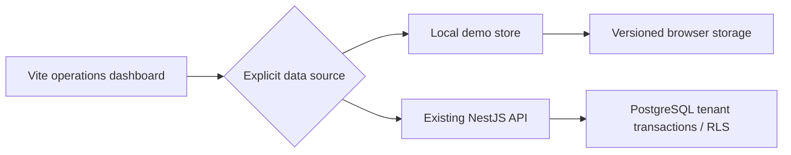

# Architecture and salvage choices

The existing Vite/JavaScript dashboard, modal/table/format components, NestJS service layer and PostgreSQL schema are retained. The repair adds the missing demonstration journey through one explicit request adapter.

`frontend/src/lib/api.js` routes requests by the selected data source. Demo failures remain errors: they never become API writes, and API failures never become fabricated demo successes. `loadData` replaces the display only after the full resource set loads and clears it on failure.

`frontend/src/lib/demo-store.js` owns fictional data, authorization illustrations, relationship validation, money and persistence. It reloads state per request, writes only after validation, and reports storage failures. It is intended for one presenter/tab, not concurrent staff or multi-device use. Each successful mutation records actor role, entity and timestamp; this is editable local activity history.

`frontend/src/lib/billing.js` calculates integer cents with half-up rounding from thousandths of a cubic metre. The bill preview and issuance share it. Bills are unique per reading with nonoverlapping account periods. Payment allocations cannot exceed the remaining bill balance. A repeated idempotency key with the same normalized payload returns the original record; conflicting details fail. Customer, account, meter and payment references have uniqueness checks.

Demo personas:

| Action | Administrator | Reader | Cashier | Accountant |
|---|---|---|---|---|
| View records/reports | Yes | Yes | Yes | Yes |
| Add customer/account | Yes | No | No | No |
| Submit reading | Yes | Yes | No | No |
| Issue bill | Yes | No | No | Yes |
| Record payment | Yes | No | Yes | No |

These checks run at the demo mutation boundary and have negative tests. The persona itself is selected by the presenter and is not a secure identity. Reset is a presenter control available in settings.

No new external runtime services, database migrations, production credentials or infrastructure are introduced. Third-party browser-test setup follows the [Playwright web-server documentation](https://playwright.dev/docs/test-webserver).

## Boundaries

The database service is preserved, compiles, and remains an integration foundation; its transactional paths have not been verified against a running database in this delivery. The browser demo is not an append-only double-entry ledger, real payment processor, multi-tenant security implementation or production replacement for the research architecture. It demonstrates the user journey and correctness constraints of that future system.
