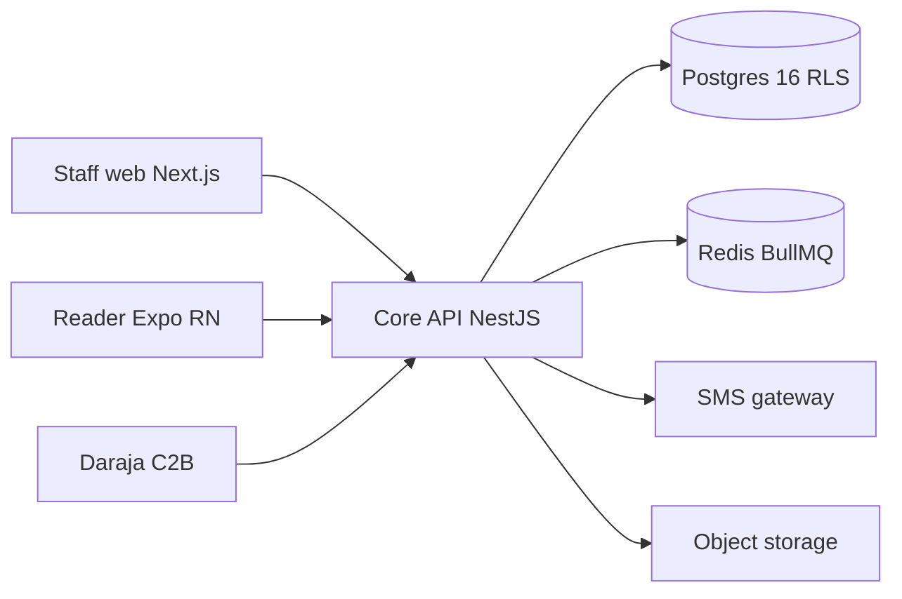
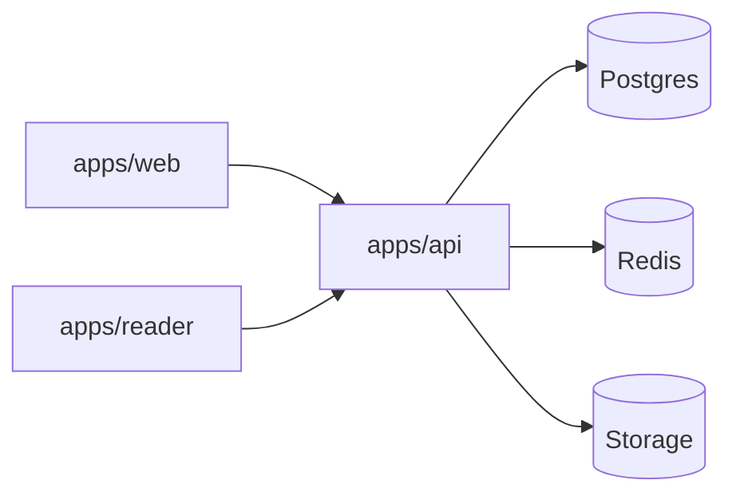

# SDR-001 — MajiBill production overview (phased pilot v1)

Status: proposed
Owner: operator
KB refs: WCSEA §2.3; Multi-tenant §2; Backend §33; Mobile §28; LPIP §1-4

## 1. Problem, users, constraints
Utilities need correct auditable billing: customers, metered
accounts, readings (often offline), tariff bills, M-Pesa/cash
collection, reconciliation, reports. Users: clerk, reader,
cashier, accountant, admin, auditor. Pilot: one tenant,
thousands of accounts, Africa/Nairobi, small staff.
Deploy: containers, same artifact for pooled/silo/sovereign.
demo-app/ stays untouched; production lives in root.
Research MB-00..MB-13 is intent; figures stay assumptions.

## 2. System context

## 3. Containers

## 4. Architecture style
D-001: modular monolith core (NestJS, one deployable).
Rejected: microservices now (no measured need, small team);
serverless-only (bill runs, outbox, pooling). Revisit on
measured triggers (see §10). KB: WCSEA §2.3; MB-01 §5.

## 5. Tenancy and truth
Tenant = utility. Pooled default; silo/sovereign same image.
tenant_id everywhere, composite FKs, RLS forced, app role
never owner/superuser. Truth: ledger sum = balance; reading
chain = consumption; tariff version = bill math; inbox row =
provider truth; audit = what happened. Minor-unit money.
