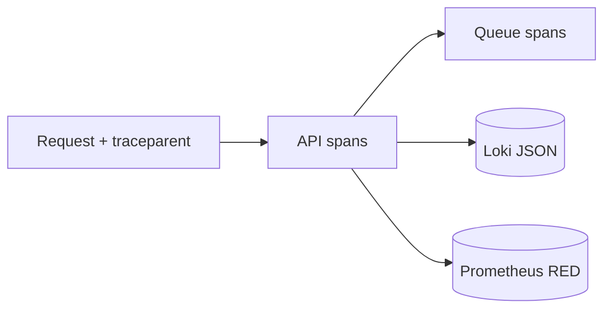

# SDR-004 — observability (logs, traces, alerts)

Status: proposed
Owner: operator
Depends on: SDR-001
KB refs: WCSEA §14; Secure-by-design logging

## Decision summary
OTel traces + JSON logs + RED/USE dashboards + security
alerts; product analytics separate with consent.

## Options considered
| Option | Fit | Cost | Risk | KB position |
|---|---|---|---|---|
| OTel + Grafana/Loki | open, portable | run it | low | default |
| Datadog SaaS | managed | fees | low | cost trigger |
| Console logs only | zero setup | blind | high | rejected |

## Chosen design

Log contract: ts, level, svc, traceId, tenantId, actorId,
event, ids only; redaction in logger; no PII/tokens.
Alerts: 401/403 spike, RLS denials, role grants, mass
export, impersonation use, queue lag, bill-run fail.
SLOs: p95 reads/writes, payment visibility, worker lag.

## Rejected alternatives
Vendor-only now: cost + portability. Unstructured logs:
unqueryable at incident time.

## Rules specs must cite
R1 every spec lists log/trace events + alerts.
R2 logs carry trace + tenant, never PII.
R3 security alerts wired before GA.

## Values this area owns
| Value | Source | Freshness | Failure behaviour |
|---|---|---|---|
| Request trace | W3C traceparent | per request | new root id |
| SLO burn | RED metrics | 1min | page on budget |

## Open questions
None allowed at approval.
