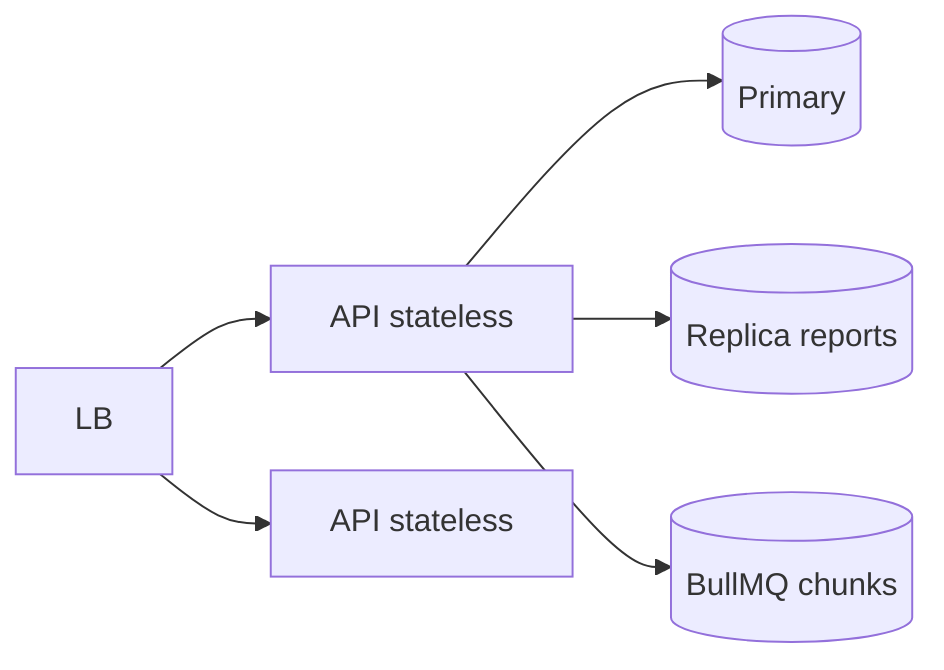

# SDR-005 — scaling (12mo and 10x)

Status: approved
Owner: operator
Depends on: SDR-001
KB refs: WCSEA scaling; MB-13 playbook

## Decision summary
Stateless API + pooled Postgres + chunked workers; cells
before sharding; per-tenant guards; skewed load test.

## Options considered
| Option | Fit | Cost | Risk | KB position |
|---|---|---|---|---|
| Vertical + replica | simple pilot | ceiling | med | start |
| Cells + workers | isolate noisy | automation | low | default path |
| Shard day one | max headroom | complexity | high | rejected |

## Chosen design

12mo: 1 tenant pilot, <50k accounts, <30 staff, bursts
~10 pay/min. 10x: multi-tenant pooled, 500k accounts,
bill runs chunked per route, replica for reports, mviews
for dashboards. Pool math: instances × pool < DB limit.
Per-tenant rate + quotas; audit time-partitioned; cell
routing seam (tenant → cell map) from day one.

## Rejected alternatives
Shard now: no evidence, ops cost. Sync bill runs inline:
timeout + overlap; workers + advisory locks instead.

## Rules specs must cite
R1 paginate every list; hot query has EXPLAIN plan.
R2 workers chunked + idempotent + advisory lock.
R3 reports prefer replica/mview path.

## Values this area owns
| Value | Source | Freshness | Failure behaviour |
|---|---|---|---|
| Per-tenant usage | usage_records daily | daily | soft-limit warn |
| Queue lag | BullMQ metrics | 10s | scale workers |

## Open questions
None allowed at approval.
