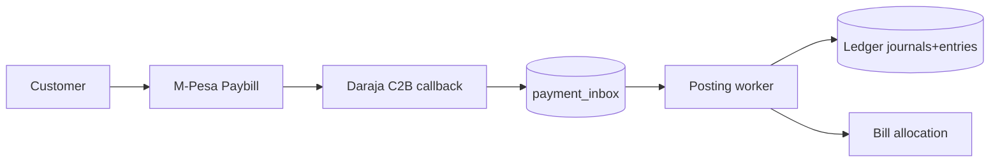

# SDR-006 — payments and ledger

Status: approved
Owner: operator
Depends on: SDR-001
KB refs: LPIP §1-7; Master §2-3, §9, §15-25

## Decision summary
Two flows apart: customer→utility via Daraja inbox +
double-entry ledger; platform subscription separate later.
Method ≠ provider ≠ rail; adapters; idempotent.

## Options considered
| Option | Fit | Cost | Risk | KB position |
|---|---|---|---|---|
| Inbox + ledger now | correct money | build | low | required |
| Direct-post no ledger | fast | irreconcilable | high | rejected |
| Gateway aggregator | coverage | fees | med | per-tenant opt |

## Chosen design

C2B validation+confirmation; STK push later. Inbox unique
(tenant, provider, provider_txn_id). Worker posts balanced
journals (debit cash/suspense, credit receivable/revenue),
allocates FIFO by due date, updates bill states. Suspense
for unmatched; reversals via reversal journals + approval.
Cash/bank manual with maker-checker. No custody: funds
settle to utility account. Tariffs versioned, never hard.

## Rejected alternatives
Ledger-less postings: cannot audit; rejected by LPIP.
Auto-guess suspense: fraud risk; human resolve only.

## Rules specs must cite
R1 every money write balanced + idempotent + audited.
R2 provider truth = inbox row, replayable.
R3 suspense never auto-applied above zero threshold.

## Values this area owns
| Value | Source | Freshness | Failure behaviour |
|---|---|---|---|
| Receipt truth | inbox + journal | <60s | suspense queue |
| Bill state | allocation sums | on post | reconcile job |

## Open questions
Paybill vs Till per tenant: operator decision at onboard.
