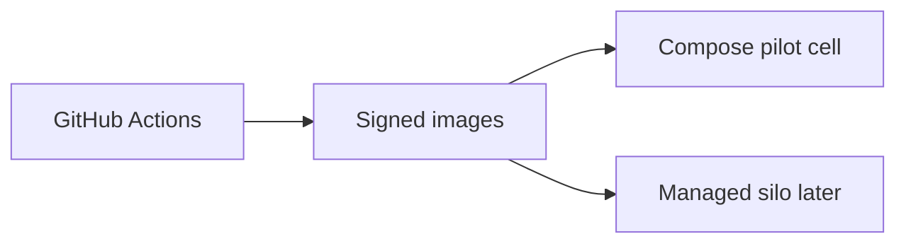

# SDR-009 — deploy and environments

Status: proposed
Owner: operator
Depends on: SDR-001
KB refs: WCSEA §4 infra matrix; MB-05 cells

## Decision summary
One artifact, three cells: compose pilot now, managed DB
where possible, Terraform path to silo/sovereign.

## Options considered
| Option | Fit | Cost | Risk | KB position |
|---|---|---|---|---|
| Compose pilot | tiny team, portable | single box | med | start |
| K8s day one | scale story | ops load | high | rejected |
| Vendor PaaS only | managed | lock-in | med | hybrid |

## Chosen design

Envs: local (compose), staging (parity + seed), pilot
prod (backups + PITR + WAF + on-call). Secrets in manager,
never images. Backups WAL + daily snapshot + encrypted
copy + quarterly restore drill. Sovereign bundle: images
+ compose/Helm + migrate job + runbooks + licence file.

## Rejected alternatives
K8s now: no measured need. Unmanaged single DB without
PITR: recovery risk.

## Rules specs must cite
R1 same artifact all cells. R2 migration job separate
from app boot. R3 restore rehearsed quarterly.

## Values this area owns
| Value | Source | Freshness | Failure behaviour |
|---|---|---|---|
| Release version | image tag + ledger | deploy | block promote |
| Backup health | restore drill log | quarterly | page owner |

## Open questions
Region/host for pilot: operator confirms in-country rule.
